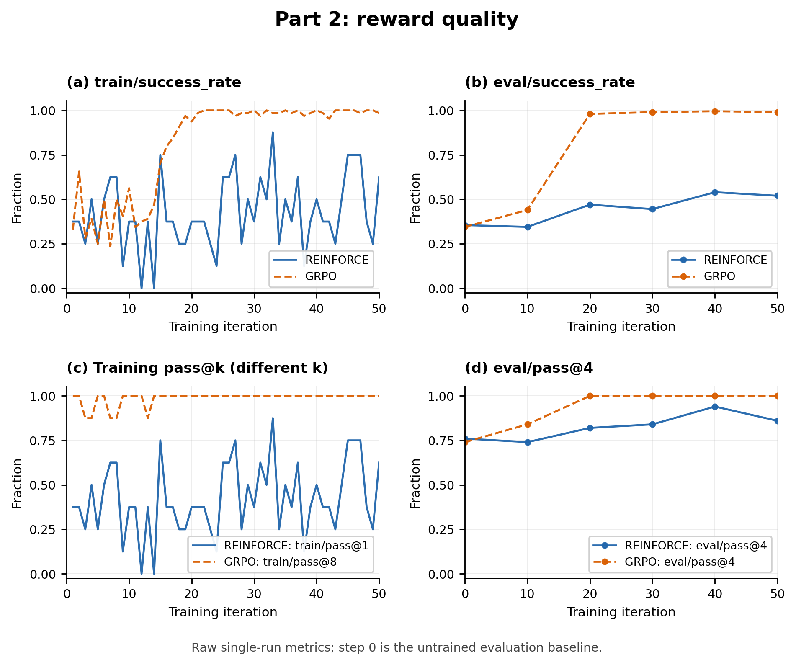
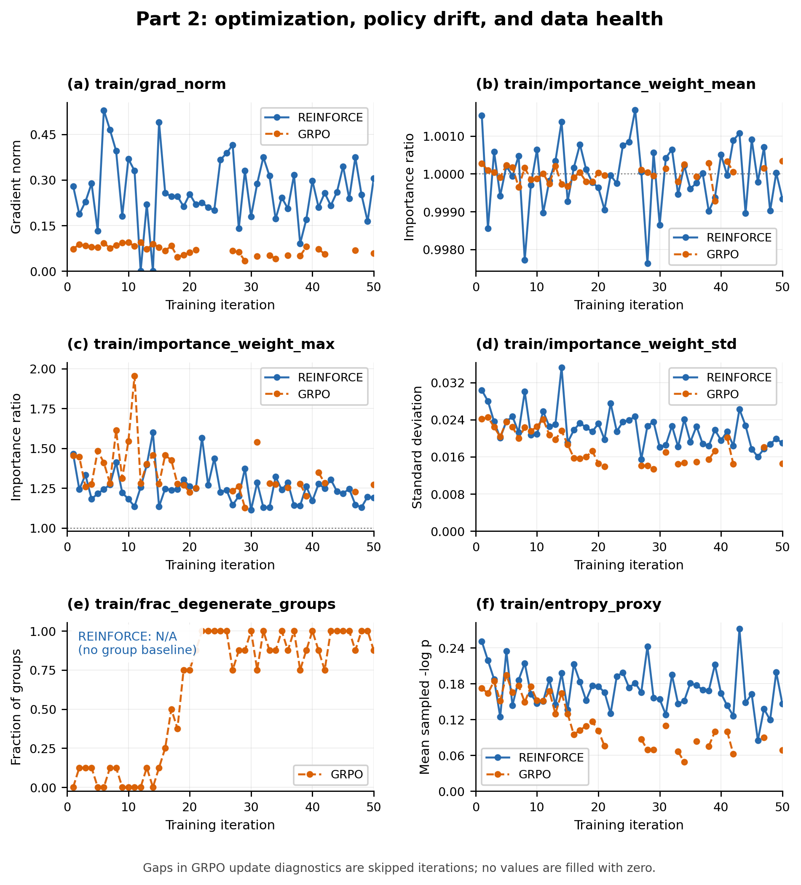

# Part 2: Synchronous REINFORCE and GRPO

## Experimental setup

I ran the provided `p2a_number_search_reinforce` and `p2b_number_search_grpo` configurations unchanged on Number Search. Both runs started independently from `Qwen/Qwen3.5-4B` with LoRA rank 32, learning rate $10^{-5}$, gradient clipping at 1.0, temperature 1.0, and seed 11768. Thinking was disabled and thinking history was preserved. Each run used eight tasks per training iteration and completed 50 iterations, with baseline evaluation at iteration 0 and evaluation every 10 iterations on the first 50 validation tasks, four rollouts per task. Each method was run once.

| Setting | p2a: REINFORCE | p2b: GRPO |
|---|---|---|
| Rollouts per task | 1 | 8 |
| Rollouts per training iteration | 8 | 64 |
| Episode advantage | Raw reward | Reward minus its group mean |
| Loss | Unclipped importance sampling | PPO |
| Training pass metric | `train/pass@1` | `train/pass@8` |
| Evaluation pass metric | `eval/pass@4` | `eval/pass@4` |

The successful p2b run used a fresh backend after a previous attempt failed while saving its baseline snapshot, before any evaluation or optimizer update. That zero-update attempt was archived and is excluded from the results below; the configurations were not changed during recovery. The metrics and figures use only the two completed formal runs, not the short probe.

## Results

| Metric | p2a: REINFORCE | p2b: GRPO |
|---|---:|---:|
| Initial evaluation success rate | 35.5% | 34.5% |
| Evaluation success rate at iteration 20 | 47.0% | 98.0% |
| Final evaluation success rate | 52.0% | 99.0% |
| Initial `eval/pass@4` | 76.0% | 74.0% |
| Final `eval/pass@4` | 86.0% | 100.0% |
| Recorded training iterations | 50 | 50 |
| Optimizer updates | 50 | 34 |
| Skipped iterations | 0 | 16 |
| Time after baseline, including periodic evaluations | 50.31 min | 32.89 min |

The timing interval starts at the recorded iteration-0 baseline result and ends at the final iteration-50 evaluation result. It excludes initial model startup, baseline evaluation, and the failed p2b startup attempt. All recorded training and evaluation abandoned-episode counts were zero, and the final sampler paths and resumable checkpoints were saved for both runs.

## Learning-speed comparison

Under the provided configurations, GRPO reached 98.0% validation success by iteration 20 and 99.0% by iteration 50, while REINFORCE reached 47.0% and 52.0%, respectively, from comparable untrained baselines of 34.5% and 35.5%. The faster rise for GRPO is consistent with the expected benefit of comparing several attempts at the same task: centered advantages can reinforce above-average attempts and suppress below-average ones, whereas REINFORCE uses the nonnegative binary reward directly. The configurations also differ in rollout count (eight versus one per task) and loss (PPO versus unclipped importance sampling), so this comparison cannot isolate the group baseline or establish superior sample efficiency. GRPO subsequently saturated on this validation subset, and its all-success groups produced 16 skipped iterations, which explains part of its shorter recorded run without showing that an individual GRPO update is inherently faster.

## Diagnostic plots

**Figure 1. Reward quality versus training iteration.** The plots show the unsmoothed `train/success_rate`, `eval/success_rate`, `train/pass@1` for REINFORCE, `train/pass@8` for GRPO, and `eval/pass@4` for both runs. The small eight-episode REINFORCE training batches fluctuate substantially; its `train/pass@1` equals its training success rate by definition. GRPO's `train/pass@8` measures whether any of eight attempts succeeds, so it must not be interpreted as the same quantity as REINFORCE's `train/pass@1`; the common evaluation metrics provide the direct held-out comparison. Both evaluation success curves finish above their baselines, and GRPO's `eval/pass@4` reaches 100% from iteration 20 onward, while REINFORCE finishes at 86%. Training rewards describe the pre-update sampling policy, whereas evaluation at the same iteration describes the current policy after that iteration's update.

**Figure 2. Optimization, policy drift, and data health versus training iteration.** The panels show `train/grad_norm`, `train/importance_weight_mean`, `train/importance_weight_max`, `train/importance_weight_std`, `train/frac_degenerate_groups`, and `train/entropy_proxy`. Mean importance weights remain close to 1 in both synchronous runs; their maxima stay below 2 and their standard deviations below 0.036, indicating small measured drift on action tokens. Gradient norms remain finite and below 0.53; their different magnitudes should be interpreted with the different advantages, batch sizes, and losses in mind. The action-token surprise proxy falls overall from 0.251 to 0.146 for REINFORCE and from 0.173 to 0.069 for GRPO, consistent with more predictable outputs, but this proxy alone does not establish policy collapse. For GRPO, it describes only retained, nondegenerate groups. GRPO's degenerate-group fraction rises as its groups become uniformly successful, reaching 1 on the 16 fully skipped iterations; the REINFORCE fraction is N/A because it has no group baseline, even though its logger records zero. Missing gradient, importance-weight, and entropy values at skipped GRPO iterations are left missing rather than replaced with zeros; those iterations remain present in the reward curves and training log.
