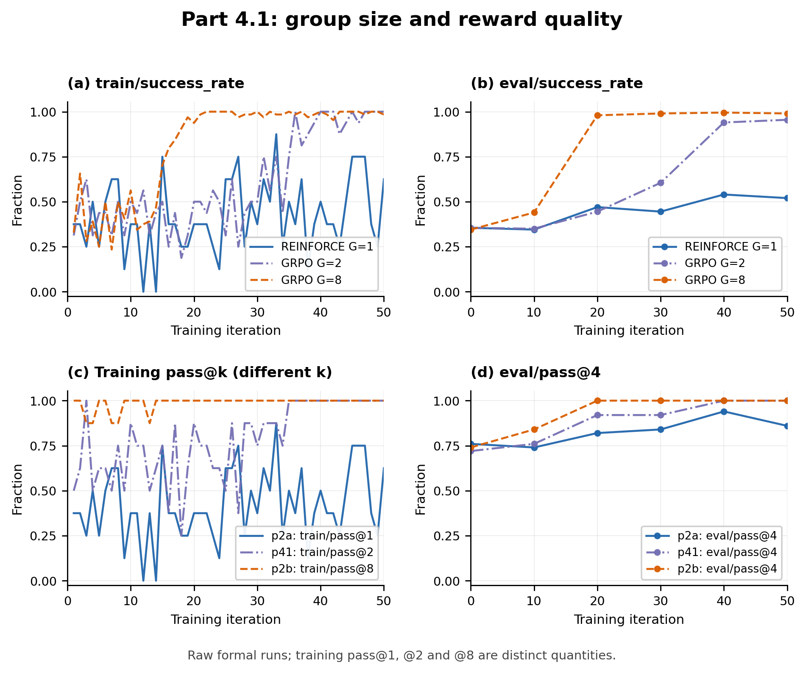
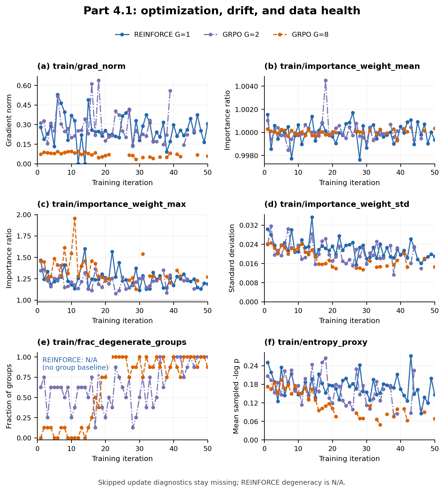
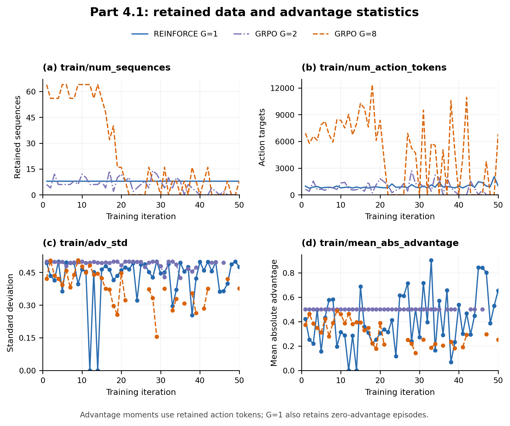

# Part 4.1: Group Size

## Setup and results

I compare the completed formal p2a, p41, and p2b runs, using their provided configs unchanged. Each starts independently from `Qwen/Qwen3.5-4B`, with LoRA rank 32, learning rate $10^{-5}$, seed 11768, eight task groups per iteration, and 50 iterations. p2a uses REINFORCE, raw rewards as advantages, and the unclipped importance-sampling loss; p41 and p2b use group-mean-centered GRPO advantages and PPO. Evaluation uses the same first 50 validation tasks with four rollouts each. Each configuration was run once; probes are excluded.

| Metric | p2a: G=1 | p41: G=2 | p2b: G=8 |
|---|---:|---:|---:|
| Initial `eval/success_rate` | 35.5% | 35.5% | 34.5% |
| Iteration-20 `eval/success_rate` | 47.0% | 44.5% | 98.0% |
| Final `eval/success_rate` | 52.0% | 95.5% | 99.0% |
| Final `eval/pass@4` | 86.0% | 100% | 100% |
| Optimizer updates / skipped iterations | 50 / 0 | 41 / 9 | 34 / 16 |
| Sampled training episodes | 400 | 800 | 3,200 |
| Retained training sequences | 400 | 282 | 1,200 |
| Retained action targets | 47,088 | 40,479 | 244,375 |
| Full-run degenerate fraction | N/A | 64.75% | 62.50% |
| First-10-iteration degenerate fraction | N/A | 55.00% | 6.25% |
| First-10 mean retained sequences / iteration | 8.0 | 7.2 | 60.0 |

G=2 improves strongly, but much later than G=8: its evaluation success is 35.0%, 44.5%, 60.5%, 94.0%, and 95.5% at iterations 10 through 50. G=8 already reaches 98% at iteration 20. REINFORCE ends at 52%, below either GRPO run. This is a descriptive comparison, not a pure group-size ablation: p2a changes both the advantage rule and loss, and the configs sample 8, 16, or 64 episodes per iteration. More progress per iteration therefore does not establish greater sample efficiency.

The usefulness of a GRPO group depends on having different rewards, not merely on completing episodes. During the first ten iterations, mean training success is similar for G=2 and G=8 (42.5% versus 41.1%), yet 44/80 G=2 groups are degenerate versus 5/80 G=8 groups. The remaining 36 pairs provide 72 sequences, whereas 75 eight-rollout groups provide 600. Thus G=2 loses a much larger fraction of its already smaller batch before learning. Retained sequence counts here match retained episodes; in general the data pipeline can split an episode into multiple sequences.

Whole-run degeneracy alone hides this early difference. G=8 quickly becomes successful, so 245 of its 250 degenerate groups are all-success and only five are all-failure. G=2 has 173 all-success and 86 all-failure degenerate groups. Late all-success groups explain why G=8 finishes with a similar total degenerate fraction despite learning much faster. Its smaller number of optimizer updates still processes many more retained sequences. All nine skipped G=2 iterations are all-success batches; iterations 47–50 skip, so the final evaluation legitimately uses the unchanged iteration-46 sampler.

<!-- pagebreak -->

## What changes in advantage variance?

For illustration, condition on a fixed task and policy with independent binary rewards of success probability p. An equal-reward group occurs with probability `p^G + (1-p)^G`; smaller groups are more likely to be degenerate. The group-mean baseline has variance `p(1-p)/G`, so G=2 provides a noisier estimate of expected reward than G=8. These formulas explain the direction of the data-loss effect without treating the heterogeneous, changing training tasks as one fixed-p experiment.

The variance of an individual centered advantage requires more care because its own reward is included in the baseline. Before filtering, `Var(r_i - group_mean) = p(1-p)(1 - 1/G)`, which is actually smaller for smaller G at fixed p. Thus it would be incorrect to say that every definition of advantage variance necessarily increases when G shrinks. Baseline-estimation noise, unconditional centered-advantage variance, and the variance of the retained training signal are different quantities.

After filtering, a retained G=2 binary group is always one success and one failure, with advantages +0.5 and -0.5 and equal-episode-weight variance 0.25. For a mixed G=8 group with k successes, that variance is `(k/8)(1-k/8)`, at most 0.25. These retained comparisons omit all zero-signal degenerate groups. The logged `train/adv_std` adds another distinction: `sequence_batch_stats` pools retained action tokens, so long episodes carry more weight than short ones. Its mean over recorded updates is 0.489 for G=2 versus 0.381 for G=8. This is consistent with the selected G=2 signal having large magnitude, but is not an estimate of unconditional episode-level variance or proof of lower gradient-estimator variance for G=8.

REINFORCE has no group baseline, so its degenerate fraction is N/A even though its logger emits 0. Its 400 retained episodes include 231 failures with zero advantage; only the 169 successful episodes have a nonzero reward-weighted signal. GRPO instead drops equal-reward groups, leaving 282 G=2 and 1,200 G=8 sequences with nonzero binary centered advantages. For fixed p, G=2 has a noisier baseline estimate; in these runs it also has larger average absolute advantages across retained action tokens and fewer useful sequences per iteration than G=8. The curves support slower early learning with G=2, while the changing policy, unequal rollout budgets, and single runs prevent an isolated causal or sample-efficiency conclusion.

## Diagnostic plots

**Figure 1. Reward quality versus iteration.** All unsmoothed `train/success_rate` and `eval/success_rate` curves are shown with every logged pass key: p2a `train/pass@1`, p41 `train/pass@2`, p2b `train/pass@8`, and each run's `eval/pass@4`. Training success rises earlier for G=8 and later for G=2; REINFORCE fluctuates without a comparable rise. Training pass@1 equals episode success, whereas pass@2 and pass@8 ask whether any attempt in a group succeeds and tend to be higher. Their different k values preclude treating them as the same metric. Evaluation pass@4 reaches 1 at iteration 20 for G=8 and iteration 40 for G=2, while per-episode success continues improving; REINFORCE ends at 0.86. Training curves use pre-update rollouts and evaluations use the snapshot at the labeled iteration. G=2 finishes at 95.5% episode success, G=8 at 99.0%, and REINFORCE at 52.0%.

**Figure 2. Optimization, importance ratios, and data health.** G=2 gradient norms span 0.134–0.637, compared with 0–0.529 for REINFORCE and 0.0335–0.0946 for G=8; their finite scales alone do not rank learning quality. IW means remain near 1 (G=2: 0.99846–1.00450), while maximum ratios reach 1.600, 1.403, and 1.954 for G=1/2/8. The highest IW standard deviations are 0.03526, 0.03156, and 0.02450, respectively, so neither the mean nor group size alone determines the tail. These are raw ratios; PPO clipping does not bound the logged ratios. Degeneracy is N/A for REINFORCE; the G=2/G=8 curves show the early data-loss difference and late all-success saturation described above. The action-token surprise proxy declines from 0.251 to 0.146, 0.207 to 0.100, and 0.173 to 0.069 for G=1/2/8. It includes predictable formatting and, for GRPO, only retained groups; declining values alone do not establish collapse. Missing update diagnostics remain gaps, while genuine zeros remain plotted.

**Figure 3. Retained data and advantage statistics.** Retained sequence counts show G=8's much larger early learning batches, G=2's smaller mixed-pair batches, and REINFORCE's constant eight sequences, including zero-advantage failures. Action-target counts also depend on episode length, so their totals need not have the same ratios as sequence counts. Fully degenerate GRPO iterations have real zeros in both data-volume panels. The `train/adv_std` and `train/mean_abs_advantage` panels instead contain gaps at empty batches. G=2 always has absolute advantage 0.5; token-length imbalance can reduce its logged standard deviation below 0.5. G=8 uses group-dependent centered rewards, with mean absolute advantage averaging 0.310 and logged standard deviation averaging 0.381 across its 34 updates. REINFORCE uses raw 0/1 rewards, making mean absolute advantage the action-token-weighted success fraction rather than a centered statistic. These conditional token-weighted moments must be distinguished from the fixed-task unconditional variance discussed above.
