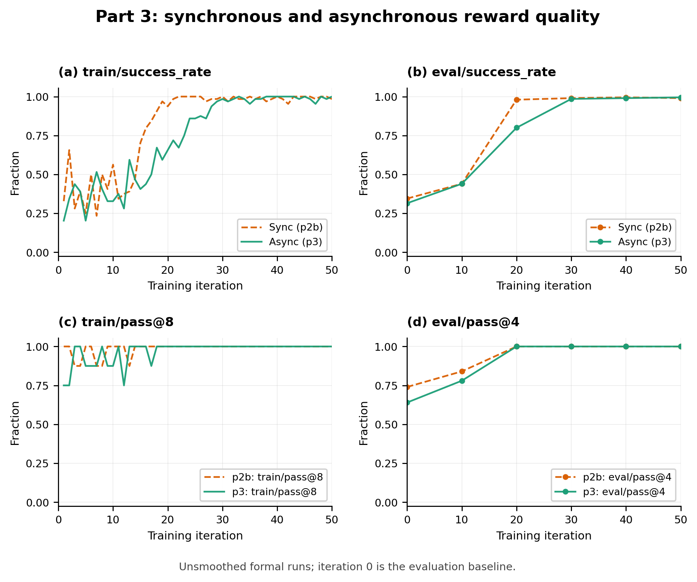
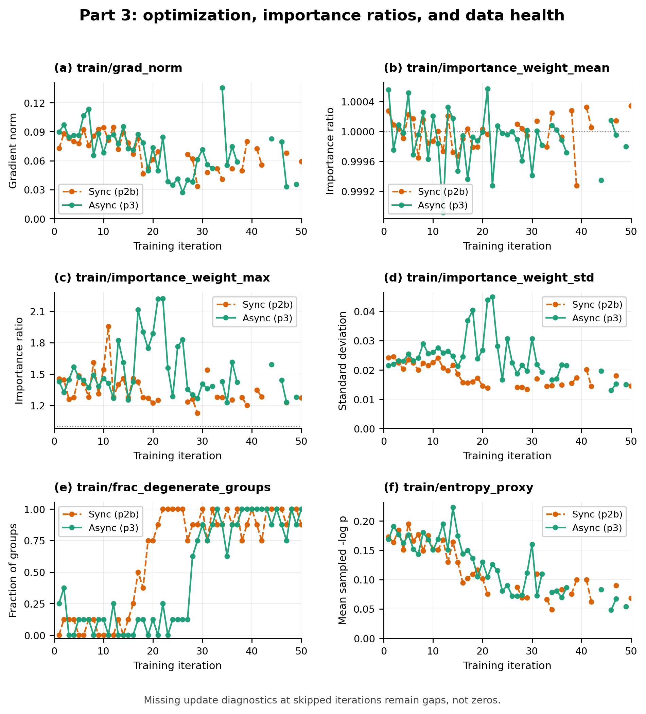
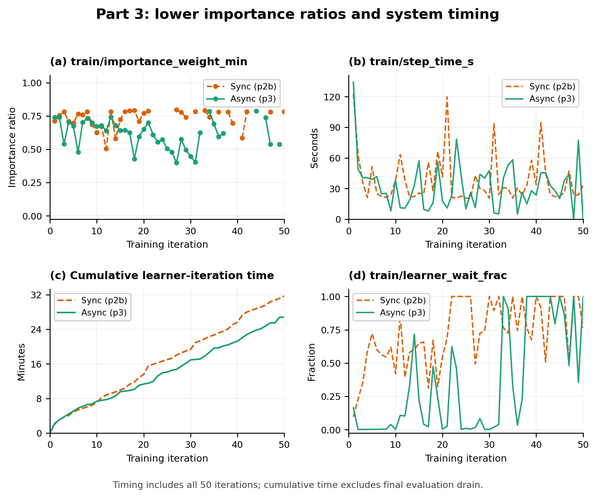

# Part 4.2: Synchronous vs. Asynchronous Training

## Results and interpretation

This comparison reuses the completed formal p2b and p3 runs from Parts 2 and 3, with no new training or probe results. Both use GRPO with eight rollouts per task, PPO, and 50 learner iterations; evaluation uses 50 validation tasks with four rollouts each. p3 uses eight workers, a queue of capacity 16, and maximum staleness 2. Each configuration was run once. The standard diagnostic figures below are reused from Part 3.

| Metric | p2b: synchronous | p3: asynchronous |
|---|---:|---:|
| Final `eval/success_rate` | 99.0% | 99.5% |
| Final `eval/pass@4` | 100% | 100% |
| Optimizer updates / skipped iterations | 34 / 16 | 40 / 10 |
| Retained training sequences | 1,200 | 1,720 |
| Mean `train/step_time_s` | 38.03 s | 32.13 s |
| Median `train/step_time_s` | 27.92 s | 27.95 s |
| Sum of iteration intervals | 31.69 min | 26.78 min |
| Time-weighted learner-wait fraction | 66.3% | 35.7% |

Across all 50 iterations, including skipped ones, asynchronous training achieves `38.0287 / 32.1329 = 1.1835` times the speed, or 15.5% less time per iteration. The intervals include first-iteration and checkpoint overhead; synchronous periodic evaluation enters the next interval, while asynchronous evaluation overlaps training. Cold start, baseline evaluation, and the final evaluation drain are excluded. Median step times are almost identical, so the improvement concerns the average and total rather than every iteration. The time-weighted learner-wait fraction, `sum(learner_wait_s) / sum(step_time_s)`, falls from 66.3% to 35.7%, consistent with overlapping rollouts and evaluation with optimization. This residual is time outside updates and sampler saves, not GPU utilization. Different GPU roles, task order, actual updates, and retained sequence counts limit attribution to scheduling alone: p2b colocates training and sampling on two GPUs, whereas p3 assigns one GPU to each role.

p3's final summary reports 71 stale groups discarded and 400 accepted: 15.1% of 471 dequeued groups, excluding queue leftovers and in-flight work at shutdown. Accepted older-policy data use PPO importance ratios. The per-update IW means remain near 1 in both runs, but p3 has wider tails: minimum 0.398 versus 0.504, maximum 2.219 versus 1.954, and highest standard deviation 0.04494 versus 0.02450. Thus the mean alone would hide the measured drift. p3 initially learns more slowly per iteration, reaching 80% evaluation success at iteration 20 versus p2b's 98%, but finishes at 99.5% versus 99.0%. There is no observed final-quality penalty in these runs; the final difference is only one episode among 200 and does not establish superiority. These observations show the tradeoff between overlap, stale-data handling, and learning progress without proving which individual mechanism caused the final result.

## Diagnostic plots

**Figure 1. Reward quality; reused from Part 3, Figure 1.** The unsmoothed curves include `train/success_rate`, `eval/success_rate`, `train/pass@8`, and `eval/pass@4` for both runs. Training success increases toward 1, while training pass@8 reaches its ceiling earlier because it measures whether any of eight attempts succeeds. Evaluation pass@4 uses a different k and reaches 1 at iteration 20 for both runs. The evaluation success curves show p3's slower initial learning and similar final quality: 99.5% versus 99.0%. Train rewards describe accepted pre-update rollouts, potentially sampled by older policies in p3. Asynchronous evaluation measures the snapshot captured at its labeled iteration even if it finishes later; p3's final evaluation uses version 40 after ten skipped iterations.

**Figure 2. Optimization and data health; reused from Part 3, Figure 2.** Gradient norms stay finite, ranging from 0.0335–0.0946 in p2b and 0.0272–0.1355 in p3. IW means remain close to 1, while p3's larger maxima and standard deviations reveal a wider upper tail; Figure 3 supplies the lower-tail comparison. These are raw action-token ratios, so values outside PPO's clipping interval do not imply that clipping failed. Degenerate-group fractions rise as groups become uniformly successful, producing 16 skipped p2b iterations and ten skipped p3 iterations. Missing gradient, IW, and entropy diagnostics at those iterations remain gaps. The sampled action-token surprise proxy falls from 0.173 to 0.069 in p2b and from 0.169 to 0.054 in p3. It reflects retained nondegenerate groups and predictable formatting as well as decisions, so its decline alone does not demonstrate collapse.

**Figure 3. Lower importance ratios and timing; reused from Part 3, Figure 3.** IW minima reach 0.504 in p2b and 0.398 in p3, completing the wider-tail comparison without a runaway ratio tail in these runs. Raw step times preserve long iterations and short skipped ones; similar medians coexist with the lower asynchronous mean. Cumulative time sums all 50 iteration intervals and ends at 31.69 versus 26.78 minutes, before the final evaluation drain. The plotted learner-wait fraction is per iteration and can equal 1 on a nearly instantaneous skipped iteration. The table therefore summarizes waiting with time-weighted fractions, 66.3% versus 35.7%, rather than averaging those plotted fractions. Reduced waiting is consistent with overlapped sampling and background evaluation, while the differing GPU roles, updates, and retained batches remain relevant to interpretation.
