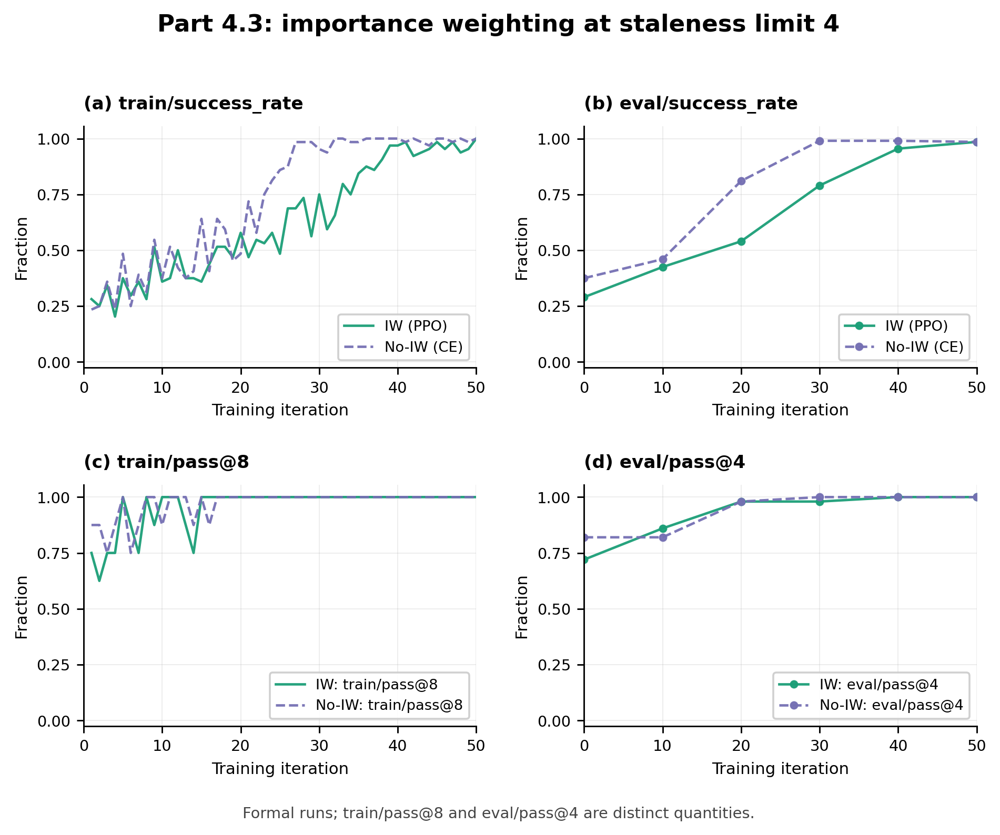
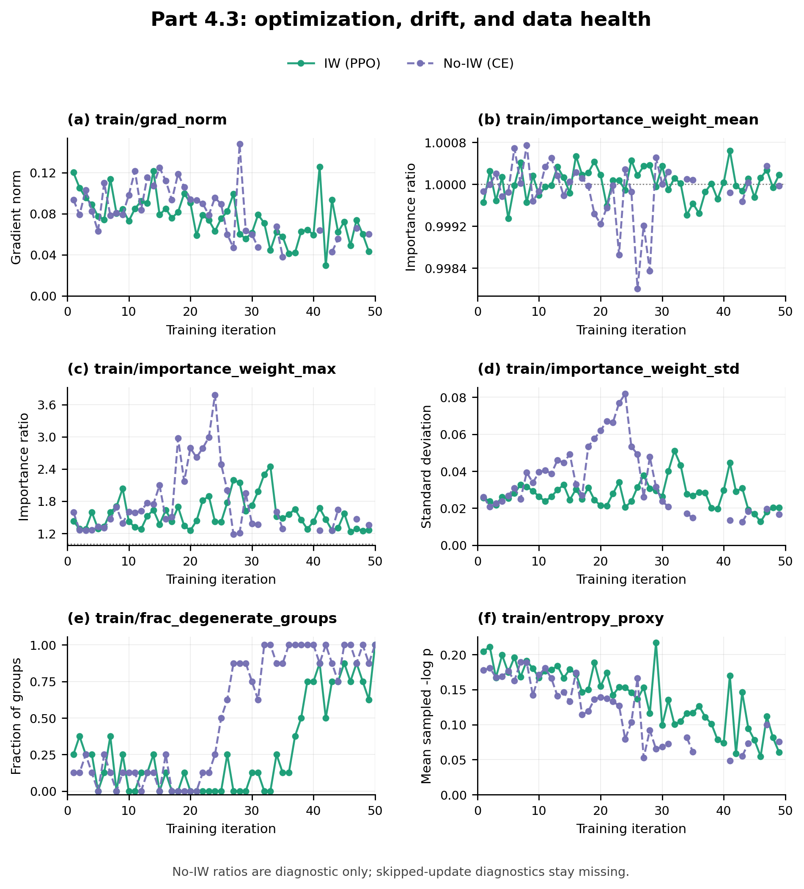
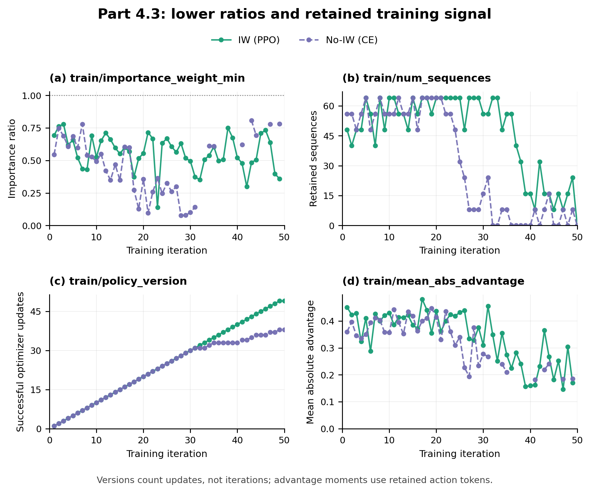

# Part 4.3: Importance Weighting under Higher Staleness

## Setup and results

I compare the completed formal `p43_number_search_async_stale4_iw` and `p43_number_search_async_stale4_noiw` runs, using the provided configs unchanged. Both independently initialize `Qwen/Qwen3.5-4B` with LoRA rank 32, learning rate $10^{-5}$, and seed 11768. Both use asynchronous GRPO, eight workers, eight groups of eight rollouts per iteration, queue capacity 16, maximum staleness 4, and 50 learner iterations. The configs differ only in loss and run name: IW uses PPO's clipped importance-weighted surrogate; noIW uses advantage-weighted cross-entropy. Each configuration was run once. Evaluation uses 50 validation tasks with four attempts each, at baseline and every ten iterations.

| Metric | IW: PPO | noIW: weighted cross-entropy |
|---|---:|---:|
| Initial `eval/success_rate` | 29.0% | 37.5% |
| Iteration-20 `eval/success_rate` | 54.0% | 81.0% |
| Iteration-30 `eval/success_rate` | 79.0% | 99.0% |
| Final `eval/success_rate` | 98.5% | 98.5% |
| Initial `eval/pass@4` | 72.0% | 82.0% |
| Final `eval/pass@4` | 100% | 100% |
| Optimizer updates / skipped iterations | 49 / 1 | 38 / 12 |
| Accepted groups / associated rollouts | 400 / 3,200 | 400 / 3,200 |
| Retained training sequences | 2,320 | 1,568 |
| Retained action targets | 394,900 | 253,012 |
| Degenerate groups / accepted groups | 110 / 400 (27.5%) | 204 / 400 (51.0%) |
| Groups dropped for excessive staleness | 0 | 0 |

Both runs learn successfully, finishing at 197 successful episodes out of 200, with at least one successful attempt on every validation task. noIW improves earlier in this realization: its evaluation success is 46%, 81%, 99%, 99%, and 98.5% at iterations 10 through 50, compared with 42.5%, 54%, 79%, 95.5%, and 98.5% for IW. Evaluation pass@4 reaches 1 at iteration 30 for noIW and iteration 40 for IW. The final decrease from 99% to 98.5% in noIW is one episode, not evidence of a substantial late failure.

More degeneracy in noIW accompanies its earlier success. All 12 skipped noIW iterations and the single skipped IW iteration contain only successful rollouts: their eight groups have identical rewards, hence zero centered advantages. They are skipped because they carry no GRPO learning signal. Mixed binary-reward groups retain all eight rollouts with nonzero centered advantages; there are 196 such groups in noIW and 290 in IW, explaining the different retained sequence totals. These counts cover groups accepted by the learner, excluding unused queued or in-flight work. Fewer updates here do not indicate an incomplete 50-iteration experiment.

<!-- pagebreak -->

## Importance ratios, data health, and interpretation

The logged action-token ratio is `rho = exp(log_pi_train - log_pi_sample)`. Across updates, IW mean ratios range from 0.99935 to 1.00064 and noIW means from 0.99801 to 1.00075. A mean near 1 therefore describes both runs, but conceals tail differences: IW reaches a minimum of 0.1402, maximum of 2.449, and peak within-update standard deviation of 0.05097; noIW reaches 0.07739, 3.780, and 0.08182, respectively. The latter run has a wider observed ratio range and larger peak dispersion, despite its earlier reward improvement and identical final success. These ratios measure sampling/training log-probability mismatch on retained action tokens; they do not directly measure a group's policy-version lag.

The noIW label describes its objective, not the absence of ratio diagnostics. `to_tinker_datum` supplies signed centered advantages as cross-entropy weights and does not supply sampling log-probabilities to that loss. The backend still returns training-time log-probabilities, allowing `importance_weight_stats` to compare them with the stored sampling values. Thus the noIW ratio curves are diagnostic only. Its advantage-weighted objective is a signed policy-gradient surrogate, so a negative reported cross-entropy loss is valid. In IW, PPO uses the ratios and clipping in its surrogate; the plotted raw ratios can lie outside the clipping interval without indicating that clipping failed.

Neither run drops an excessively stale group, but this does not establish that all accepted groups were sampled by the current policy. The filter rejects a group only when the current learner version minus its generation version exceeds 4; accepted groups can be older by up to four updates. Final sampler versions are 49 and 38, matching actual optimizer updates rather than the shared 50-iteration counter. Evaluations refer to the snapshot captured at their labeled iteration, even if asynchronous evaluation completes later. These logs provide the rejection counts and mismatch diagnostics, not a complete histogram of accepted version lags.

All recorded metrics are finite, and all logged abandoned-episode counts are zero. Gradient norms range from 0.02935 to 0.12584 for IW and 0.03797 to 0.14788 for noIW. Action-token surprise and mean absolute advantage generally decrease as success rises, but describe retained nondegenerate groups and weight episodes by their action-token counts. They are not unconditional episode-level entropy or advantage statistics. Diagnostics requiring a training batch are absent on skipped iterations; zero retained sequences is a real observation rather than a missing value.

This ablation does not show that importance weighting is always required or always dispensable. The specified change replaces the entire PPO surrogate with weighted log-likelihood, removing its ratio dependence and clipping together. Different baseline success rates, stochastic trajectories, retained sample counts, and update counts also limit causal attribution. In these two runs, removing that correction did not prevent learning or reduce final measured success, although its ratio tails were wider. Multiple independent trials and richer lag measurements would be needed to generalize beyond this configuration; one run per configuration does not estimate variation across training runs.

## Diagnostic plots

**Figure 1. Reward quality versus learner iteration.** Both unsmoothed training-success curves rise toward 1; noIW's evaluation-success curve rises earlier, reaching 99% at iteration 30 while IW is at 79%, before both finish at 98.5%. Training pass@8 is higher than per-episode success and approaches its ceiling earlier in both runs because it asks whether any of eight attempts succeeds. Evaluation pass@4 reaches 1 at iteration 30 for noIW and 40 for IW. Training metrics include all accepted groups, including degenerate ones, and describe pre-update rollouts that can come from older policies. Evaluation metrics describe the captured snapshot; the final snapshots are versions 49 and 38 rather than version 50.

**Figure 2. Optimization, importance-ratio moments, and data health.** Gradient norms stay finite in both runs, without a late explosion. The IW-mean panel stays close to 1 for both losses, while the IW-maximum and IW-standard-deviation panels reveal larger peaks in noIW: 3.780 and 0.08182 versus 2.449 and 0.05097. Ratios in noIW are diagnostics, and raw ratios in PPO are not bounded by its clipping interval. Degenerate-group fractions rise as training success approaches 1, more frequently producing all-degenerate batches in noIW. The sampled action-token surprise proxy generally declines in both runs, from 0.205 to 0.060 in IW and 0.178 to 0.076 in noIW, using the first and last nonempty batches. It includes predictable formatting and only retained groups, so its decline alone does not prove policy collapse. Missing gradient, IW, and entropy values remain gaps at skipped iterations.

**Figure 3. Lower ratio tail, retained data, policy versions, and advantages.** IW minima fall to 0.1402 with PPO and 0.07739 with weighted cross-entropy, complementing the upper-tail comparison. Retained sequence counts shrink as groups become uniformly successful; they sum to 2,320 for IW and 1,568 for noIW, with real zeros at one and 12 skipped iterations. Policy-version curves advance only after an optimizer update and finish at 49 and 38; noIW's late plateaus correspond to skipped all-success batches. Mean absolute advantage is the action-token-weighted magnitude among retained mixed groups: it generally declines from 0.451 to 0.171 for IW and 0.360 to 0.185 for noIW, using nonempty endpoint batches. It is absent at empty batches and must not be interpreted as the mean across all sampled episodes or as a direct measure of policy lag.
