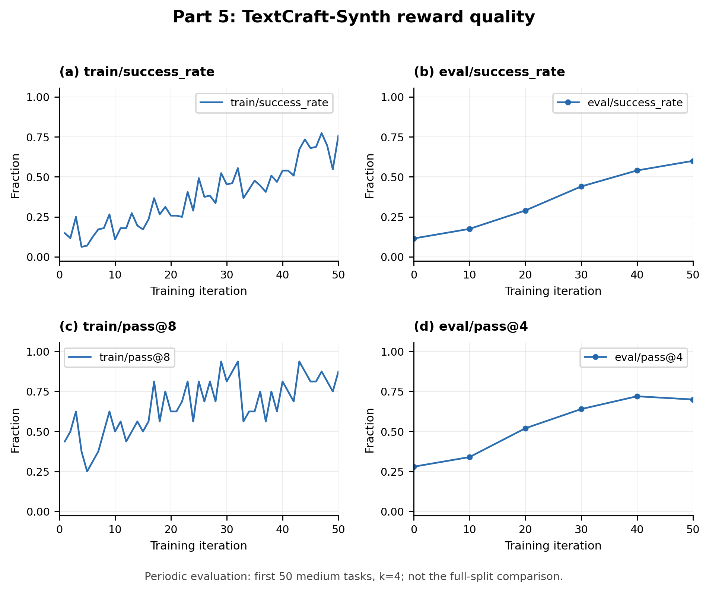
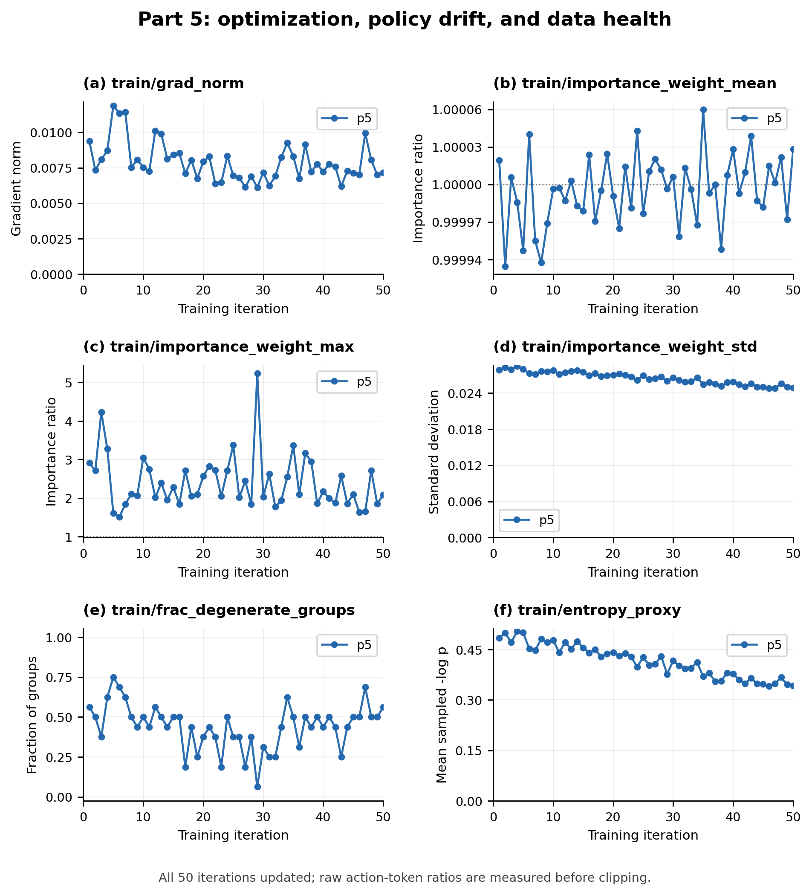
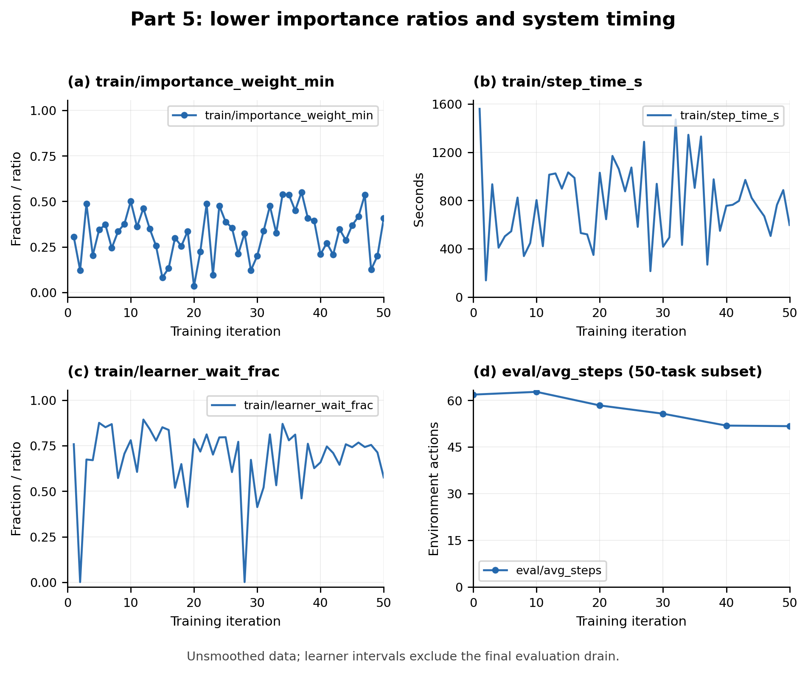

# Part 5: TextCraft-Synth

## Setup and training outcome

I ran the provided `p5_textcraft_grpo` configuration unchanged, once, from `Qwen/Qwen3.5-4B` with LoRA rank 32. Asynchronous GRPO used PPO, learning rate $10^{-5}$, 32 rollout workers, queue capacity 16, 16 groups of eight rollouts per learner iteration, and maximum staleness 4. Thinking and preserved thinking history were enabled, with 512 generated tokens per turn and temperature 1.0. The run completed all 50 iterations and 50 optimizer updates without resuming; it consumed 800 groups and dropped zero groups for excessive staleness. The final sampler was `tinker://model_71bf8a90/v50`.

Periodic evaluation used the first 50 medium validation tasks, four attempts each. Its success rate rose from 11.5% at baseline to 17.5%, 29.0%, 44.0%, 54.0%, and 60.0% at iterations 10 through 50. Periodic pass@4 rose from 28% to 70%, with a slightly higher 72% at iteration 40; a one-task difference among 50 does not establish late deterioration. All iterations retained mixed-reward groups, yielding 3,578 training sequences and 36,315,974 retained action targets. The training log records 16 abandoned training episodes and seven abandoned periodic-evaluation episodes, all retained as failures.

## Final full-split comparison

I evaluated the final adapter and the unmodified base model through the supplied standalone vLLM deployment. Each model received the full 213-task medium split and 136-task hard split, with four attempts per task: 852 and 544 episodes, respectively. Both used the same supplied agent, environment, chat template, thinking settings, generation limits, and scoring. The following table uses these complete splits, not the 50-task periodic subset.

| Model | Split | `success_rate` | `pass@4` |
|---|---|---:|---:|
| Fine-tuned v50 | Medium | 62.21% (530/852) | 77.46% (165/213) |
| Fine-tuned v50 | Hard | 0.18% (1/544) | 0.74% (1/136) |
| Base Qwen3.5-4B | Medium | 11.15% (95/852) | 27.70% (59/213) |
| Base Qwen3.5-4B | Hard | 0.00% (0/544) | 0.00% (0/136) |

On medium, fine-tuning improves per-episode success by 51.06 percentage points and pass@4 by 49.77 points. The mean completed environment-action count also falls from 61.83 to 49.48, consistent with more effective behavior, although this average mixes successes, budget-exhausted failures, and early-abandoned episodes and is not a success-only efficiency measure. On hard, both models remain near zero: the experiment shows strong improvement on the training difficulty but does not demonstrate strong transfer under the supplied harder-split budget. One training run and one evaluation batch per condition do not estimate variation across independent training runs, and the infrastructure failures below limit an infrastructure-free interpretation.

<!-- pagebreak -->

## Failure accounting and the hard split

Every abandoned episode remains in the original denominator with reward zero; none was removed or replaced. Fine-tuned medium has 18 abandoned episodes: 17 HTTP 408 responses and one parser `TypeError`. Fine-tuned hard has 37: 15 HTTP 502 responses, 15 `RemoteProtocolError`, four `ConnectError`, two `ReadError`, and one parser `TypeError`. Base medium has none; base hard has one HTTP 502 and one parser `TypeError`. Thus communication failures and malformed model output are reported separately. All four commands reached their final result JSON. The two base evaluations used a progress-only wrapper around the supplied evaluator: the wrapper changed no tasks, model settings, concurrency, scoring, or retry rules and added no sampling calls.

The instructor's Piazza clarification, “Part 5: one HTTP 408 during hard-split evaluation after upstream fix,” permits reporting an aborted episode as a failure and identifies a known hard-split issue. I retain and disclose the counts above, including the larger number of communication failures in this run, rather than treating that guidance as evidence that the failures had no effect. The reported success rates are the observed failure-inclusive outcomes, not estimates with infrastructure failures silently corrected. The earlier evaluation-endpoint patch was already present; evaluation used the direct vLLM endpoint rather than a stopped Tinker training session.

A separate static inspection of the supplied data reveals a concrete budget constraint. Every craftable item has one recipe, initial inventories contain only base materials, and one `craft` call produces only one item type, even when its quantity is batched. Counting the distinct required craftable ancestors therefore gives a lower bound on craft calls; the mandatory `finish()` adds one more action. For 84 of 136 hard tasks, this lower bound exceeds the fixed 75-action budget; no medium validation task violates that bound. This permits shared intermediates and batching, and even assumes perfect recipe knowledge and no wasted queries. It does not prove that the other 52 hard tasks are impossible or explain every failure, and I cannot identify it with certainty as the instructor's undisclosed root cause. The original datasets, environment, and budgets were left unchanged for every reported run.

## System diagnostics and exported adapter

The mean learner-iteration time was 772.13 s; all 50 intervals sum to 10.72 hours. From the baseline result to the final periodic evaluation, elapsed time was 10.98 hours, including a 15.21-minute final evaluation drain but excluding startup and baseline evaluation. Time-weighted learner waiting was 73.6%, consistent with substantial rollout and other non-update time; this residual is not GPU utilization. Zero stale rejections does not imply that every accepted group was on-policy: groups up to four updates old remain admissible.

The exported public repository is `Marstbowl/scottyrl-a3-p5_textcraft_grpo`, recorded as `hf_model_id` in the run's checkpoint manifest. Its adapter configuration identifies the correct Qwen base and rank 32; the uploaded `adapter_model.safetensors` SHA256 matches the same file extracted from the final v50 archive. The export used the supplied script's local-directory option, so it uploaded the already evaluated weights without another training-server download. The repository will remain public until grades are released.

## Diagnostic plots

**Figure 1. Reward quality versus learner iteration.** These are the unsmoothed `train/success_rate`, `eval/success_rate`, `train/pass@8`, and `eval/pass@4` curves from the hero run. Training success increases from 14.84% to 75.78%, with batch-to-batch variation; training pass@8 rises from 43.75% to 87.50%. Pass@8 measures whether any of eight attempts succeeds and must not be equated with episode success or evaluation pass@4. The periodic evaluation curves use only the first 50 medium tasks; success rises to 60%, while pass@4 reaches 72% then finishes at 70%. Training rewards describe accepted pre-update rollouts, potentially from older policies. Evaluations use the snapshot captured at their labeled iteration, even when they finish later. The full-split comparison appears in the four-row table.

**Figure 2. Optimization, importance ratios, and data health.** Gradient norms remain finite at 0.00612–0.01187. IW means are very close to one (0.999935–1.000060), but the maximum reaches 5.240 and within-update standard deviation ranges from 0.02480 to 0.02848; the lower tail appears in Figure 3. A near-one mean therefore does not establish identical sampling and training distributions. These are raw action-token ratios, so PPO clipping does not bound the plotted maxima. Degenerate-group fractions vary between 6.25% and 75%, averaging 44.125%; none empties an entire batch. Such groups can be uniformly successful or uniformly unsuccessful, so degeneracy alone is not evidence of saturation. The sampled action-token surprise proxy decreases from 0.485 to 0.343. It measures retained nondegenerate groups and includes format tokens, so it is not full-distribution entropy or proof of collapse.

**Figure 3. Lower ratio tail, timing, and episode length.** IW minima reach 0.03427, complementing the upper tail in Figure 2; mean ratios near one can conceal this mismatch. Step times range from 138.02 to 1,559.21 s, so the long run cannot be described by one constant step duration. The learner-wait fraction shows the raw per-iteration residual; the text instead summarizes waiting with its time-weighted 73.6%. Timing includes update/checkpoint and sampler-save overhead, and excludes the final evaluation drain. Periodic `eval/avg_steps` first rises from 61.85 to 62.73 and then falls to 51.70 as success improves. This includes failed and abandoned episodes, so it does not by itself establish a shorter successful crafting plan. All curves use original recorded values without smoothing, omitted failures, or added retries.
